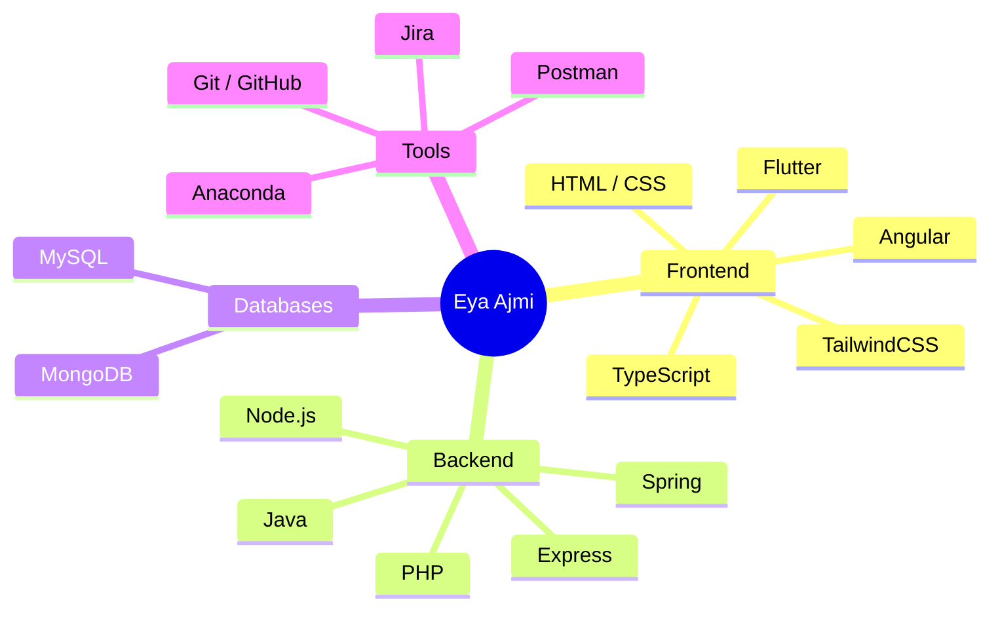

<div align="center">


<br/><br/>

<a href="https://www.linkedin.com/in/ajmieya13" target="_blank"></a>
<a href="https://mail.google.com/mail/?view=cm&fs=1&to=ajmieya13@gmail.com" target="_blank" rel="noopener noreferrer"></a>
<a href="https://wa.me/21695441814" target="_blank"></a>

<br/><br/>


</div>

---

## 👩‍💻 About me

```js
const eya = {
  role: "Junior Software Developer",
  location: "Tunisia 🇹🇳",
  focus: ["Full-Stack Web", "REST APIs", "Clean Code"],
  stack: ["Java", "Spring", "Angular", "Node.js", "MongoDB", "MySQL"],
  currentlyLearning: ["TypeScript", "Software Architecture", "Testing"],
  openTo: ["Internships", "Junior roles", "Collaborations"],
  funFact: "I enjoy solving problems more than I enjoy the bugs I create 😄",
};
```

---

## 🧭 My tech universe



<details>
<summary><b>🛠 Full tech stack (click to expand)</b></summary>
<br/>

**Languages**


**Frontend & Mobile**


**Backend & APIs**


**Databases**


**Tools & IDEs**


</details>

---

## 📊 GitHub analytics

<div align="center">


</div>

---

## 🐍 Contribution snake

<div align="center">
  <picture>
    <source media="(prefers-color-scheme: dark)" srcset="https://raw.githubusercontent.com/Eyaajmii/Eyaajmii/output/github-snake-dark.svg" />
    <source media="(prefers-color-scheme: light)" srcset="https://raw.githubusercontent.com/Eyaajmii/Eyaajmii/output/github-snake.svg" />
    
  </picture>
</div>

> Generated automatically every day by a GitHub Action (see `.github/workflows/snake.yml`).

---

## 🚀 Featured projects

<!-- Replace the placeholders with your real repositories -->

<div align="center">

<a href="https://github.com/Eyaajmii/REPO-1"></a>
<a href="https://github.com/Eyaajmii/REPO-2"></a>

<a href="https://github.com/Eyaajmii/REPO-3"></a>
<a href="https://github.com/Eyaajmii/REPO-4"></a>

</div>

---

## 🎯 Goals 2026

- [x] Build full-stack projects with Angular and Node.js / Spring
- [ ] Strengthen TypeScript and testing practices
- [ ] Contribute to open-source projects
- [ ] Land a junior developer role or internship

---

## 🏆 Trophies

<div align="center">
  
</div>

---

## 💬 Daily dev quote

<div align="center">
  
</div>

---

## 📫 Let's connect

Always happy to talk about code, projects or opportunities. Reach me on [LinkedIn](https://www.linkedin.com/in/ajmieya13) or by [email](mailto:ajmieya13@gmail.com).

<div align="center">
  
</div>
